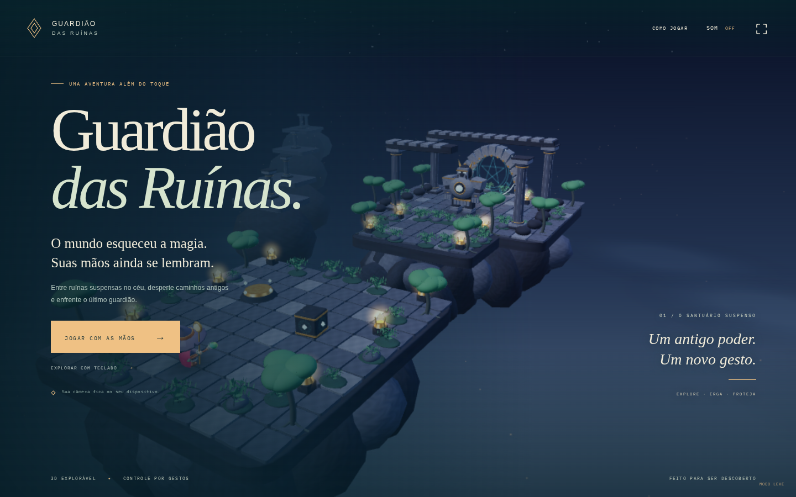

# Guardião das Ruínas

**[Jogar no navegador](https://guardiao-das-ruinas.vercel.app/)** · [Repositório](https://github.com/vicksa/Guardi-o-das-ru-nas-)

Uma aventura 3D para navegador controlada pelas mãos, com teclado e toque como alternativas. Explore três ilhas flutuantes, erga o bloco luminoso com telecinese, desperte a passagem e enfrente um guardião de pedra com ataques sinalizados no chão.



## Executar

```sh
npm ci
npm run dev
```

Abra o endereço exibido pelo Vite. A webcam exige HTTPS ou localhost. Sem câmera, escolha Explorar com teclado; no celular, Jogar com toque. O mundo 3D precisa de WebGL 2. O modo leve reduz resolução e desliga sombras; ele também é ativado automaticamente em renderizadores por software ou se a taxa de quadros inicial estiver baixa.

## Controles

| Ação             | Mãos                                                                                       | Teclado                 |
| ---------------- | ------------------------------------------------------------------------------------------ | ----------------------- |
| Avançar / recuar | Esquerda um pouco acima / abaixo do centro                                                 | W / S ou ↑ / ↓          |
| Virar            | Esquerda para os lados                                                                     | A / D ou ← / →          |
| Parar            | Voltar ao centro ou fechar o punho esquerdo                                                | Soltar direção          |
| Pular            | V com a direita, inclusive andando; manter repete ao pousar                                | Espaço                  |
| Magia            | Fechar o punho direito para carregar; abrir a palma para lançar                            | Segurar J ou Q e soltar |
| Escudo           | Manter a palma direita aberta                                                              | Segurar K ou Shift      |
| Telecinese       | Pinça direita: polegar e indicador juntos, outros dedos abertos; desfazer antes de repetir | E                       |
| Pausa            | Botão Pausar                                                                               | Esc                     |

Perto do bloco, use telecinese para erguê-lo. Aproxime-se do pedestal circular e use novamente para encaixar. A ponte restaurada deixa um pequeno vão que exige pular até a segunda ilha. Atravessar cria um refúgio. O guardião marca o chão antes de atacar: saia do círculo, pule ou mantenha o escudo. Quatro magias totalmente carregadas derrotam seus 12 pontos de vida.

A prévia espelhada das mãos fica visível durante preparação, missão e reinício. Centralizar redefine o centro sem exigir grandes movimentos; Trocar lados permite corrigir rótulos. Perder as mãos interrompe os comandos e a missão espera automaticamente; devolver ambas retoma. As ações de troca de modo/desligamento exigem clique ou toque; a permanência do cursor das mãos só ativa os botões principais explicitamente habilitados. A câmera não é encerrada ao morrer, reiniciar, pausar ou mudar para teclado — apenas ao desligá-la, cancelar a conexão ou sair da página.

## Verificações

```sh
npm test
npm run build
npx playwright install --with-deps chromium
npm run test:e2e
npm run format:check
```

Os testes incluem a missão completa por entradas normais, controles simultâneos, quedas/reinício, falhas de permissão e detecção de duas mãos fotografadas pelos modelos reais. São usadas câmera sintética e imagens controladas: não substituem validação com iluminação, webcam e aparelho físicos. Evidências e limites em [docs/VALIDATION.md](docs/VALIDATION.md).

## Implementação

TypeScript, Vite e Three.js. Regras independentes da renderização em `src/simulation.ts`; gestos em `src/controls.ts`; captura e recuperação em `src/tracking.ts`; arte procedural e animação em `src/world.ts` e `src/art/`; interface em `src/main.ts`. A física usa passo fixo de 1/60 s, com limite de recuperação por quadro. A inspeção de estado dos testes existe somente em desenvolvimento e é removida do build de produção.

A captura reutiliza a base de recuperação desenvolvida no Game-air, com fallback MediaPipe GPU → CPU → TensorFlow.js/WASM. O modo compatível não depende de WebGL para reconhecimento, mas o cenário 3D continua exigindo WebGL 2. Modelos e runtimes são servidos pelo próprio site. Nenhuma imagem de câmera é enviada a um servidor.

## Publicação

Site estático na Vercel; configuração em `vercel.json`. GitHub Actions executa unidade, build e testes de navegador. Sem banco de dados, contas ou segredos no cliente. Sons sintetizados opcionais, inicialmente desligados. Mago KayKit CC0 com esqueleto e animações, arquitetura/guardião procedurais e materiais PBR; fontes, motores e modelos conservam suas próprias licenças, descritas em [docs/ASSETS.md](docs/ASSETS.md).

## Skills de 3D

Dez skills do pacote [CloudAI-X/threejs-skills](https://github.com/CloudAI-X/threejs-skills) estão instaladas em `.agents/skills/`, com licença MIT e commit de origem registrados em [docs/3D-SKILLS.md](docs/3D-SKILLS.md). Incluem materiais, iluminação, geometria, texturas, animação, carregamento de modelos, otimização e pós-processamento. O mago possui 12 clips esqueléticos e transições de animação; o modo leve preserva os modelos e os materiais e desliga sombras/bloom para reduzir o custo gráfico.
